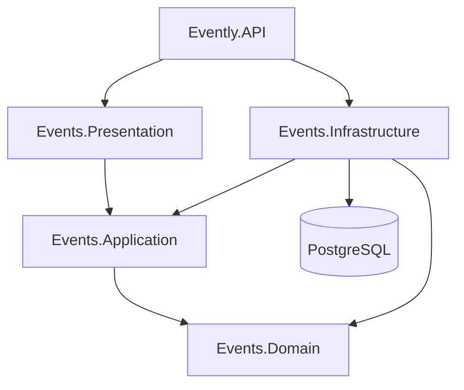

# Evently

**An event-management backend exploring modular monolith architecture.**

`C#` · `.NET 10` · `DDD` · `CQRS` · `PostgreSQL` · `Docker`

Evently is a course-based architectural study focused on explicit module boundaries, domain events and separation of application, domain, infrastructure and presentation responsibilities.

## Events module

- Create and retrieve event use cases with separate command and query handlers.
- Event domain entity, status and event-created domain event.
- Module-specific repository, database context, migrations and unit-of-work abstractions.
- ASP.NET Core endpoint registration and Development OpenAPI.
- Docker Compose development environment with PostgreSQL and a database health check.

## Architecture



[Modules/Events](Modules/Events/) contains the four Events projects. [API/Evently.API](API/Evently.API/) is the host and composition root.

## Getting started

Use the .NET SDK in [global.json](global.json) and Docker Compose.

```bash
git clone https://github.com/I-Do-CS/Evently.git
cd Evently
dotnet restore Evently.slnx
dotnet build Evently.slnx
```

Review [docker-compose.yml](docker-compose.yml) and application configuration before starting the API and database:

```bash
docker compose config
docker compose up --build
```

Compose maps the API to port 5000. Development startup maps OpenAPI and applies migrations. Inspect the Events presentation endpoints for request contracts.

Course-based implementation maintained by [Ali Ghelichkhani](https://github.com/I-Do-CS).
